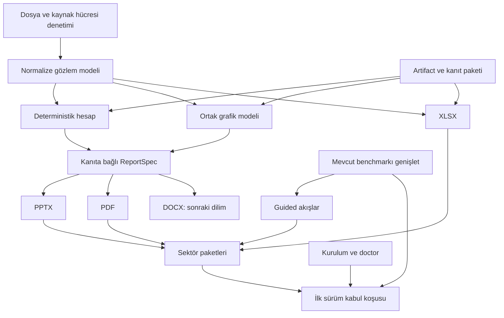

# Midterm sonrası TÜİK MCP araştırması ve ürün yol haritası

Araştırma tarihi: **18 Kasım 2026, Europe/Istanbul**. Amaç: mevcut çalışan MCP'yi, farklı sektörlerde kullanılabilecek, doğrulanabilir analiz ve düzenlenebilir kurumsal çıktılar üreten bir ürüne taşımak.

## Karar

Önerilen ürün vaadi: **“TÜİK sorusundan, her sayısı kaynağına bağlanabilen düzenlenebilir sunuma ve rapora.”** İlk ürün dilimi aynı kanıt paketinden XLSX, PPTX ve PDF üretmeli. Grafik, hesap, metin ve kaynakça bu dosyalarda aynı veriyi kullanmalı. İlk hedef kullanıcılar finans/makro araştırma, imalat/dış ticaret ve yerel politika/araştırma ekipleri.

Bu bir ürün stratejisi çıkarımıdır; henüz kullanıcı görüşmeleriyle doğrulanmış talep veya rakiplere karşı ölçülmüş üstünlük değildir. Genişlik ve düşük kurulum yükü konusunda güçlü rakipler var. Kaynak gösterme, CSV ve büyüme hesabı tek başına özgün özellik sayılmaz. İncelenen doğrudan rakiplerin araç arayüzlerinde **kanıt bağları korunmuş, ortak veri modeli kullanan düzenlenebilir PPTX + XLSX + PDF iş akışı** görmedim. Bu, araştırılan commit'lerle sınırlı bir boşluk gözlemidir; “piyasada hiç yok” iddiası değildir.

## Araştırma kapsamı ve kanıt sınırı

Altı doğrudan TÜİK MCP projesinin README, ilgili sunucu/adapter kodları ve mevcut test dosyaları incelendi. Bir geniş kamu verisi MCP'si ve bir hazır veri/MCP hizmeti komşu ürün olarak karşılaştırıldı. Kod depoları sabit commit kimlikleriyle indirildi. Rakipler kurulup aynı görevlerde çalıştırılmadı; dolayısıyla aşağıdaki değerlendirmeler canlı hizmet kalitesi veya başarı oranı sıralaması değildir. Test dosyalarının varlığı, testlerin bu oturumda geçtiği anlamına gelmez. Kimlik doğrulama gerektiren servislerde kişisel anahtar kullanılmadı.

Kendi ürünümüzde yerel checkout ile uzaktaki `develop` ayrı incelendi. Uzak `develop`: [`ea26bb4e8e1f`](https://github.com/ByRock010/TUIK-Data-MCP-Server/tree/ea26bb4e8e1fd05eed815e4def469b527da9191a), commit tarihi 12 Kasım 2026. Böylece yerelde olmayan hibrit arama ve 8 Kasım benchmark çalışması yanlışlıkla yeni iş olarak açılmadı.

İndirilen kaynaklar ve metadata yerelde `output/research/tuik-roadmap-2026-11-18/evidence/` altında. Bu dizin ham üçüncü taraf kaynaklarını içerir; inceleme kanıtıdır, proje koduna bağımlılık olarak eklenmedi. İnceleme uygulama kodunu değiştirmedi, branch/tag/release oluşturmadı.

## Rakip karşılaştırması

| Proje / incelenen sürüm | İddia ve kodda görülen güçlü taraf | Belgelenen veya koddan görülen sınır | Bizim için anlamı |
| --- | --- | --- | --- |
| [orhoncan/tuik-mcp](https://github.com/orhoncan/tuik-mcp/tree/2c682e8ee9d84b47d8e46cc2389a8671cddb2b27) | SDMX için arama → boyut seçimi → filtreli çekim; kod/etiket çözümü, son dönem ve otomatik token yenileme. | API anahtarı gerekir. `tuik_cek` satır sınırı indirme/parse sonrasında uygulanır; `limit=0` sınırı kaldırır. İncelenen ağaçta test dizini yok. Office raporlama arayüzü görülmedi. | Resmî boyut/codelist ve sunucuda filtreleme değerlidir; erişimi kolaylaştırırken kaynak bütçelerimizi korumalıyız. |
| [ahmthamza/turkiye-veri-mcp](https://github.com/ahmthamza/turkiye-veri-mcp/tree/ebb2fa3b7d1363545c7eca1165eee037121fdb03) | DataBrowser üzerinden anahtarsız TÜİK boyut/filtre erişimi; TCMB, BDDK, HMB; tidy CSV; geniş dosya denetimi ve hosted kullanım. | “Tüm” kapsamı farklı erişim katmanlarını kapsıyor: MEDAS/Biruni bağlantı düzeyinde. README 515 akışın 508'inin doğrulandığını söylüyor. Excel dönüşümü çıkarım/kısmi/ret durumları içeriyor. Hosted `output_path` kullanıcıya indirme sağlamıyor. | En güçlü kapsam rakiplerinden. Dosya kapsamını ve doğru etiketlemeyi ölçmeliyiz. Gerçekten indirilebilir, kaynağı korunmuş Office dosyaları değerli ayrışma adayı. |
| [noahsilv/tuikdata MCP](https://github.com/noahsilv/tuikdata/tree/90ccd70262ed7839e109032525f84f4ee760a8f5/mcp-server) | Portal + SDMX + CIP coğrafi veri/sınırlar; TR/EN; boyut/codelist; çevrimdışı fixture testleri. | “All data” ifadesi garanti edilmiş veri kapsamı değildir. SDMX anahtar ister. `statistical_data` önce veriyi çekip sonra offset dilimi döndürür; bu arayüz bizim snapshot'a bağlı devam garantimizi sağlamıyor. Harita geometrisi sunmak, hazır kurumsal harita/rapor üretmek değildir. | Haritayı yeni fikir diye sunamayız. Doğru coğrafya/dönem eşleşmesi, okunabilir görsel ve çıktı kalitesiyle ilerlemeliyiz. |
| [ulascan54/VeriTR-MCP](https://github.com/ulascan54/VeriTR-MCP/tree/2c934a336f11d59ac5d70731b80c32e78fcecf46) | Normalize gösterge kataloğu, dönem/coğrafya eşleme, bölge/seri karşılaştırma, deterministik analiz; TÜİK/TCMB/belediye adapterleri. Demo vaatlerini test eden dosyalar var. | Normalize kapsam seçilmiş registry ile sınırlı; gelecekteki kurumlar mevcut destekten ayrılmış. README hosted endpoint'in henüz olmadığını belirtiyor. İncelenen sunucu araçlarında PPTX/PDF üretimi yok. | Normalizasyon ve hesap araçları zaten rekabet tabanı. Aynı başlangıç döneminde karşılaştırma, gözlem düzeyinde kanıt ve çıktı tutarlılığına odaklanmalıyız. |
| [YusufBeratZengin/tuik-data](https://github.com/YusufBeratZengin/tuik-data/tree/93ea84d0e89d83b04eebf84dd0e0a5ec632d7743) | Standart kütüphane ile JSON-stat/SDMX-JSON okuma, durum bayrakları, SQLite saklama, CLI ve dört MCP aracı. | MCP keşfi yerel sekiz gösterge kataloğu üzerinden; satır çıktısı 500 ile kesiliyor, araçta devam parametresi yok. README normal testlerin canlı anahtarlı erişimi kanıtlamadığını açıkça söylüyor. Office çıktısı görülmedi. | Küçük kurulum ve çevrimdışı tekrar kullanımdan öğrenilebilir. Genel keşif ve kurumsal çıktı ayrı ihtiyaçlar. |
| [turkyilmazomer/tuik-mcp](https://github.com/turkyilmazomer/tuik-mcp/tree/c431b3ecf4eb8dd256b4e8c599e13d2062772d95) | .NET, Streamable HTTP, 17 kullanıcı odaklı araç, hazır nüfus/işsizlik/enflasyon/eğitim soruları. | Kod gömülü JSON okuyor. README bazı sayıların yaklaşık/yuvarlanmış olduğunu ve eğitim/il işsizliği kapsamının 20 il + Türkiye olduğunu belirtiyor. “Latest” araç adı, canlı TÜİK'teki en yeni yayına erişim garantisi vermiyor. | Kolay sorulara erişim iyi; güncellik ve kesinlik konusunda bizim canlı kaynak yaklaşımımız korunmalı. |

Birinci satırın [sunucu kodu](https://github.com/orhoncan/tuik-mcp/blob/2c682e8ee9d84b47d8e46cc2389a8671cddb2b27/src/tuik_sdmx_mcp/server.py), üçüncü satırın [sayfalama kodu](https://github.com/noahsilv/tuikdata/blob/90ccd70262ed7839e109032525f84f4ee760a8f5/mcp-server/src/tuik_mcp/server.py), beşinci satırın [MCP arayüzü](https://github.com/YusufBeratZengin/tuik-data/blob/93ea84d0e89d83b04eebf84dd0e0a5ec632d7743/src/tuik_data/mcp_server.py) ve altıncı satırın [gömülü veri okuyucusu](https://github.com/turkyilmazomer/tuik-mcp/blob/c431b3ecf4eb8dd256b4e8c599e13d2062772d95/src/TuikMcp.Infrastructure/Data/EmbeddedJsonDataProvider.cs) iddia/kod ayrımının dayanaklarıdır.

İkinci projenin [kapsam raporu](https://github.com/ahmthamza/turkiye-veri-mcp/blob/ebb2fa3b7d1363545c7eca1165eee037121fdb03/COVERAGE.md) ve [Excel ölçümü](https://github.com/ahmthamza/turkiye-veri-mcp/blob/ebb2fa3b7d1363545c7eca1165eee037121fdb03/ISTAB_PROBE.md) özellikle önemli: 1.700 dosyalık kendi ölçümünü ve ayrılmış değerlendirme kümesini yayımlıyor. Bu sayıları biz yeniden doğrulamadık. Kendi 12 dosyalık fixture kapsamımızı bu raporla doğrudan başarı oranı olarak karşılaştıramayız; dosya seçimi ve doğruluk tanımı farklı.

Komşu ürünler:

- [BerkantACUN/mcp-turkiye](https://github.com/BerkantACUN/mcp-turkiye/tree/68836ba6b4d2a43270b7ed279c1602ab9b6e03cc), geniş Türkiye kamu verisi, npx kurulumu ve MCP prompt örnekleri sunuyor. İncelenen il/nüfus modülü tarihli gömülü bir derlemeyi kullanıyor; bunu canlı TÜİK SDMX erişimiyle aynı saymamak gerekir. Derin TÜİK tablo/metodoloji araştırmasından çok genel asistan kapsamıyla komşu rakip.
- [Ortak Veri](https://ortakalan.io/veri/api/), 7 Kasım tarihli sayfasında 40 derlenmiş veri seti için anahtarsız JSON/CSV ve MCP tanıtıyor. Kaynak/dönem içeren hazır cevaplar ve kurulum kolaylığı güçlü. Kendi tanımıyla derlenmiş kapsamla sınırlı. Backend kodu ve canlı MCP davranışı bu araştırmada incelenmedi; genel TÜİK kapsamıyla eş tutulmadı.

## Pazarın yönü ve teknik sonuçlar

[TCMB, resmî EVDS-MCP'yi 26 Ekim 2026'da duyurdu](https://www.tcmb.gov.tr/wps/wcm/connect/TR/TCMB%2BTR/Main%2BMenu/Duyurular/Basin/2026/DUY2026-46). Çıkarım: veri erişimi sunan adapterlerin tek başına savunulabilirliği azalabilir. Kurumlar erişimi kendileri sağlayabilir; kullanıcının işi için güvenilir analiz ve çıktı katmanı hâlâ değerli kalabilir. Bu, TÜİK'in gelecekte resmî MCP çıkaracağına dair doğrulanmış bir bilgi değildir.

[Resmî TÜİK SDMX belgesi](https://veriportali.tuik.gov.tr/en/sdmx-web-service-documentation), API anahtarı ve token akışını açıklıyor. Rakibin anahtarsız DataBrowser yolu farklı, portalın arka uç yüzeyi. İkisini “resmî SDMX anahtarsız” diye birleştirmemeliyiz. Önce kapsama ve trafik kazancını ölçüp sonra birini opsiyonel adapter olarak seçmek doğru.

[MCP Apps](https://apps.extensions.modelcontextprotocol.io/api/) etkileşimli grafik ve form için resmî uzantı sunuyor. İstemci ve sürüm desteği değişebileceğinden mevcut PNG/metin/structuredContent yolu korunmalı. UI ilk PPTX/PDF için önkoşul değil. Ürünün SDK 1.x sınırıyla uyumluluk ayrıca doğrulanmalı.

PowerPoint'te düzenlenebilir grafikler [python-pptx](https://python-pptx.readthedocs.io/en/latest/user/charts.html), Excel grafikleri mevcut [openpyxl](https://openpyxl.readthedocs.io/en/stable/charts/introduction.html) üzerinden üretilebilir. Bunlar aday uygulama yolları; incelenen dokümanlar uçtan uca editör uyumluluğunu kanıtlamaz. PDF için küçük bir [WeasyPrint](https://doc.courtbouillon.org/weasyprint/stable/)/[ReportLab](https://docs.reportlab.com/) karşılaştırması sonrası tek renderer seçilmeli.

[Google Slides API](https://developers.google.com/workspace/slides/api/guides/overview) sunum yazmayı destekliyor; [Drive](https://developers.google.com/workspace/drive/api/guides/manage-uploads) dosya yükleme/dönüştürme yolu sağlıyor. [Microsoft Graph](https://learn.microsoft.com/en-us/graph/api/overview?view=graph-rest-1.0) için dosya/Excel erişimini genel PowerPoint düzenleme API'si varsayımına çevirmiyoruz. Önce portable çıktı, ardından mevcut istemci bağlayıcılarıyla kompozisyon, ancak ölçülen ihtiyaç varsa özel connector öneriliyor.

## Mevcut ürünün korunacak üstünlükleri ve açıkları

Dokuz araç; CSV/Excel/PDF okuma; sütun/değer inceleme; snapshot'a bağlı sorgu devamı; Türkçe arama ve açık fallback; kaynak URL/zaman; PNG grafik mevcut. `develop` ayrıca opsiyonel hibrit arama ve içerik indeksini içeriyor. Bu işlevler tekrar açılmıyor. [8 Kasım benchmark'ı](https://github.com/ByRock010/TUIK-Data-MCP-Server/blob/ea26bb4e8e1fd05eed815e4def469b527da9191a/docs/verification/mcp-benchmark-2026-11-08.md) 10 soruda MCP'nin güçlü sonuçlarını kaydediyor; tek koşu ve aynı aile model değerlendirmesiyle sınırlı, rakip MCP karşılaştırması değil.

Kapatılması gereken ürün açıkları: gözlem düzeyinde veri anlamı ve kaynak hücresi, dosya kapsamının daha geniş ölçümü, deterministik hesap, çıktıların kullanıcı tarafından indirilebilmesi, tüm formatlarda aynı sayılar, düzenlenebilir Office nesneleri, yeni kullanıcı kurulumu ve görev düzeyinde değerlendirme. Geçici snapshot/cursor mekanizması kalıcı rapor arşivi değildir; indirilen dosyanın hash'i olmadan eski raporu yeniden üretme iddiası kurulmamalı.

## Önceliklendirme ve yürütme

İlk sürüm dilimi 14 işten oluşur. Sonraki 11 iş genişleme kuyruğudur; hepsini bitirmek ilk çıktı sürümünün koşulu değildir. Boyut tahminleri S/M/L göreli karmaşıklığı belirtir; teslim tarihi veya sprint taahhüdü değildir. Mevcut v0.4.0 milestone'u değiştirilmedi; yeni sürüm numaraları ekip kapasitesi ve kalan dönem takvimi netleşince seçilmeli.

| Öncelik | Sonuç | Gerekçe |
| --- | --- | --- |
| Önce | Mevcut benchmark'ı 24 sektör/görev senaryosuna genişletmek; 60 dosyalık katmanlı parser denetimi | Talebi ve hata türlerini sayısal olarak görmek; eski benchmark'ı tekrarlamamak. |
| Temel | Normalize gözlem/kanıt modeli, kalıcı ve sınırlı artifact paketi, deterministik hesap | Yanlış birim veya dönemle üretilmiş güzel sunumu önlemek. |
| Çıktı | Ortak grafik/rapor modeli, XLSX, düzenlenebilir PPTX, PDF | Kullanıcının istediği somut ürün ve güçlü ayrışma hipotezi. |
| Kullanım | Guided MCP akışları, temiz kurulum/doctor, üç sektör paketi, kabul koşusu | Teknik kapasiteyi günlük kullanılabilir işe çevirmek. |
| Sonra | DOCX, tekrar üretim/revizyon farkı, MCP Apps | İlk dilimden bağımsız ek değer. |
| Araştırma kararıyla | Hosted HTTP, SDMX/DataBrowser, harita, Workspace/M365, resmî EVDS kompozisyonu | Erişim/izin/işletme yükü ve kullanıcı faydası ölçülmeden geniş kapsam taahhüdü vermemek. |

**Ayrı başlanabilecek işler:** benchmark, dosya denetimi, artifact altyapısı ve kurulum. Hibrit arama sorunları [#78](https://github.com/ByRock010/TUIK-Data-MCP-Server/issues/78) ve [#79](https://github.com/ByRock010/TUIK-Data-MCP-Server/issues/79) mevcut işler olarak aynı sırada ele alınabilir. [#80](https://github.com/ByRock010/TUIK-Data-MCP-Server/issues/80) dataset hibrit değerlendirmesi opsiyonel araştırmadır; Office renderer'larını bloklamaz. Genel [#25 roadmap](https://github.com/ByRock010/TUIK-Data-MCP-Server/issues/25) tarihsel bağlam olarak korunur; yeni epic'e bir devam bağlantısı eklenir.

Her issue mevcut repo üslubuyla İngilizce `Goal / Context / Proposal / Acceptance criteria / TÜİK sources involved / Dependencies` içerir. Ek olarak faz, göreli boyut ve araştırma kapısı yazılır. Gerçek teknik engeller GitHub `blocked by`, yalnızca ilişkili işler `Related`, epic kapsamı ise alt issue ilişkileriyle ayrı tutulur. Bir araştırma no-go kararı verirse ona bağlı uygulama işi yapılmış sayılmaz; gerekçesiyle yeniden planlanır.

## Başarı tanımı ve ertelenenler

Örnek ilk demo: “Son 24 aylık yayımlanmış fiyat ve işgücü verilerini getir, yıllık değişimle yüzde puan farkını doğru ayır, kurum şablonumda altı slayt ve kısa PDF oluştur; Excel'de kaynakları ve hesap girdilerini de ver.” Dosyalardaki her sayı kaynağa/hesaba bağlanmalı; kaynakta olmayan bir bölgesel kırılım açıkça reddedilmeli.

Hedef kabul eşiği: önceden sabitlenen destekli görevlerde en az %90 başarı ve çözülmemiş kritik sayı/birim/dönem/kaynak hatası olmaması. Aynı görevler iki istemcide tekrarlı koşulmalı; render edilen tüm sayfalar/slaytlar ve workbook okunabilirliği incelenmeli. Bunlar gelecekteki kabul hedefleridir, mevcut ölçüm sonucu değildir. Rakipsiz olma iddiası ancak eş koşullarda rakip testleri ve bağımsız kullanıcı kanıtıyla ayrıca değerlendirilebilir.

İlk dilime alınmayanlar: evrensel SQL/kod çalıştırma, bütün kurumlara adapter, mikroveri, otomatik tahmin/nedensellik, tüm PDF'lere OCR, otomatik e-posta/Teams dağıtımı, tam BI platformu ve sınırsız kurum şablonu desteği. İleri aşamada ihtiyaç ölçülürse ayrı işlere dönüştürülebilir. Statik görseller için üretken görsel modelinin sayı/eksen çizmesine ihtiyaç yok; gerçek veriden deterministik grafik üretimi yeterli ve denetlenebilir.

## GitHub kayıtları

Ana epic: [#84 — Post-midterm roadmap](https://github.com/ByRock010/TUIK-Data-MCP-Server/issues/84). **25 alt iş** açıldı; aynı kaynak ve biçimde İngilizce açıklamalar yer alır.

| Sıra / iş grubu | Issue'lar |
| --- | --- |
| Kanıt ve kapsam | [#85 görev benchmarkı](https://github.com/ByRock010/TUIK-Data-MCP-Server/issues/85), [#86 dosya/hücre denetimi](https://github.com/ByRock010/TUIK-Data-MCP-Server/issues/86) |
| Veri ve kanıt altyapısı | [#87 gözlem modeli](https://github.com/ByRock010/TUIK-Data-MCP-Server/issues/87), [#88 artifact paketi](https://github.com/ByRock010/TUIK-Data-MCP-Server/issues/88), [#89 hesaplar](https://github.com/ByRock010/TUIK-Data-MCP-Server/issues/89) |
| Ortak çıktı modelleri | [#90 grafikler](https://github.com/ByRock010/TUIK-Data-MCP-Server/issues/90), [#91 rapor modeli](https://github.com/ByRock010/TUIK-Data-MCP-Server/issues/91) |
| Dosya çıktıları | [#92 XLSX](https://github.com/ByRock010/TUIK-Data-MCP-Server/issues/92), [#93 PPTX](https://github.com/ByRock010/TUIK-Data-MCP-Server/issues/93), [#94 PDF](https://github.com/ByRock010/TUIK-Data-MCP-Server/issues/94), [#95 DOCX — sonraki dilim](https://github.com/ByRock010/TUIK-Data-MCP-Server/issues/95) |
| Kullanım ve kabul | [#96 guided akışlar](https://github.com/ByRock010/TUIK-Data-MCP-Server/issues/96), [#97 sektör paketleri](https://github.com/ByRock010/TUIK-Data-MCP-Server/issues/97), [#98 kurulum](https://github.com/ByRock010/TUIK-Data-MCP-Server/issues/98), [#100 sürüm kabulü](https://github.com/ByRock010/TUIK-Data-MCP-Server/issues/100) |
| Devamlı kullanım | [#99 revizyon/yenileme](https://github.com/ByRock010/TUIK-Data-MCP-Server/issues/99), [#101 MCP Apps](https://github.com/ByRock010/TUIK-Data-MCP-Server/issues/101) |
| Hosted hizmet | [#102 tasarım araştırması](https://github.com/ByRock010/TUIK-Data-MCP-Server/issues/102) → [#103 koşullu uygulama](https://github.com/ByRock010/TUIK-Data-MCP-Server/issues/103) |
| Boyutlu erişim | [#104 SDMX/DataBrowser araştırması](https://github.com/ByRock010/TUIK-Data-MCP-Server/issues/104) → [#105 koşullu adapter](https://github.com/ByRock010/TUIK-Data-MCP-Server/issues/105) |
| Coğrafya | [#106 coğrafya araştırması](https://github.com/ByRock010/TUIK-Data-MCP-Server/issues/106) → [#107 koşullu harita pilotu](https://github.com/ByRock010/TUIK-Data-MCP-Server/issues/107) |
| Kurumsal entegrasyonlar | [#108 Workspace/M365 pilot araştırması](https://github.com/ByRock010/TUIK-Data-MCP-Server/issues/108), [#109 resmî EVDS kompozisyonu](https://github.com/ByRock010/TUIK-Data-MCP-Server/issues/109) |

Tam issue gövdeleri `output/research/tuik-roadmap-2026-11-18/issues/`, oluşturma kaydı `github-state.json`, plan `plan.json` içindedir. Yerel plan döngü açısından kontrol edildi. GitHub issue gövdeleri, etiketleri, alt iş sırası ve bağımlılıkları yeniden okunarak doğrulandı: **25 alt issue, 32 gerçek blocked-by ilişkisi**, doğru epic üyeliği ve ilk sürümün önde olduğu sıralama. Sonuç `github-verification.json` dosyasına kaydedildi. Mevcut #25 roadmap'ine [devam bağlantısı](https://github.com/ByRock010/TUIK-Data-MCP-Server/issues/25#issuecomment-6980315762) eklendi.
