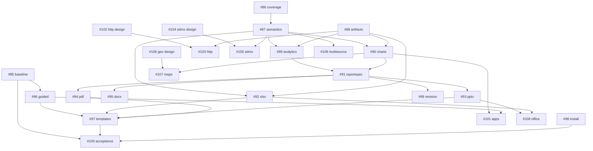

## Goal

Turn a TÜİK question into a reproducible, source-correct, editable business deliverable: the same evidence bundle produces XLSX, PPTX and PDF. Prioritize finance/macro research, manufacturing/export and local policy/research workflows. Make differentiation measurable rather than claiming universal or untested superiority.

## Context and research method — 18 November 2026

Reviewed the existing issues, local source, midterm limitations and remote `develop` at `ea26bb4e8e1fd05eed815e4def469b527da9191a`. The current nine tools, table inspection/query pagination, PNG charts, optional hybrid/content search and **existing 8 November 10-question benchmark** are prior work, not new implementation requests. #78–#80 remain the existing ranking follow-ups; no duplicate issues are created.

Six direct TÜİK MCP repositories were inspected at pinned commits through README, relevant implementation and available test files. Two adjacent services were considered for breadth/onboarding. Competitor servers were **not installed and benchmarked live**; observed code paths and published self-reports must not be interpreted as verified production reliability. Personal/API-key-only endpoints were not exercised. This is a bounded review, not an exhaustive market census.

## Competitive findings

| Project / pinned source | What is already strong | Scope or gap relevant to this plan |
| --- | --- | --- |
| [orhoncan/tuik-mcp @2c682e8](https://github.com/orhoncan/tuik-mcp/tree/2c682e8ee9d84b47d8e46cc2389a8671cddb2b27) | Guided SDMX discovery, dimension/code selection, server filters, token lifecycle. | Requires a key. Fetch output is capped after download/parse and can be unlimited with `limit=0`; no test directory in reviewed tree. No institutional-output tools observed. |
| [ahmthamza/turkiye-veri-mcp @ebb2fa3](https://github.com/ahmthamza/turkiye-veri-mcp/tree/ebb2fa3b7d1363545c7eca1165eee037121fdb03) | Key-free DataBrowser dimensions/filters, TÜİK+EVDS+BDDK+HMB, tidy CSV, hosted access and broad extraction audit. | README differentiates 508 verified flows from 515 catalogued flows; MEDAS/Biruni are link-only. Extraction has inferred/partial/rejected cases. Hosted `output_path` writes to the server rather than delivering a download. |
| [noahsilv/tuikdata @90ccd70, MCP](https://github.com/noahsilv/tuikdata/tree/90ccd70262ed7839e109032525f84f4ee760a8f5/mcp-server) | Portal+SDMX+CIP, bilingual labels, dimension structure, geographic boundaries and fixture tests. | SDMX needs a key. `statistical_data` downloads/parses before slicing offset pages, without our snapshot-bound continuation contract. Boundary output is not an edited map/report workflow. |
| [ulascan54/VeriTR-MCP @2c934a3](https://github.com/ulascan54/VeriTR-MCP/tree/2c934a336f11d59ac5d70731b80c32e78fcecf46) | Normalized indicators, regions/periods, comparisons, deterministic analytics, provider separation and tests of README promises. | Selected indicator registry, not universal normalization. Hosted endpoint is described as roadmap work. No reviewed tool produces the shared editable Office/PDF evidence bundle proposed here. |
| [YusufBeratZengin/tuik-data @93ea84d](https://github.com/YusufBeratZengin/tuik-data/tree/93ea84d0e89d83b04eebf84dd0e0a5ec632d7743) | Lightweight cube parsing, observation status, SQLite, CLI and four MCP tools. | MCP discovery uses eight local catalogue indicators; output caps at 500 rows without a continuation input. Ordinary tests do not establish authenticated live availability. |
| [turkyilmazomer/tuik-mcp @c431b3e](https://github.com/turkyilmazomer/tuik-mcp/tree/c431b3ecf4eb8dd256b4e8c599e13d2062772d95) | HTTP endpoint and 17 task-oriented tools over easy population/labour/inflation/education questions. | Embedded JSON rather than live retrieval; README admits approximate/rounded figures and selected-province coverage. A `latest` tool name does not establish the latest official release. |

Important implementation evidence: [orhoncan fetch path](https://github.com/orhoncan/tuik-mcp/blob/2c682e8ee9d84b47d8e46cc2389a8671cddb2b27/src/tuik_sdmx_mcp/server.py), [noahsilv paging](https://github.com/noahsilv/tuikdata/blob/90ccd70262ed7839e109032525f84f4ee760a8f5/mcp-server/src/tuik_mcp/server.py), [tuik-data MCP cap](https://github.com/YusufBeratZengin/tuik-data/blob/93ea84d0e89d83b04eebf84dd0e0a5ec632d7743/src/tuik_data/mcp_server.py), [embedded .NET data loader](https://github.com/turkyilmazomer/tuik-mcp/blob/c431b3ecf4eb8dd256b4e8c599e13d2062772d95/src/TuikMcp.Infrastructure/Data/EmbeddedJsonDataProvider.cs).

The strongest extraction-coverage lesson comes from the [published istab probe](https://github.com/ahmthamza/turkiye-veri-mcp/blob/ebb2fa3b7d1363545c7eca1165eee037121fdb03/ISTAB_PROBE.md) and [coverage report](https://github.com/ahmthamza/turkiye-veri-mcp/blob/ebb2fa3b7d1363545c7eca1165eee037121fdb03/COVERAGE.md): they publish a large retained-file sample and held-out checks. Those results were not independently rerun here. Our small fixture corpus and their sample have different selection/rubrics and cannot support a direct accuracy ranking.

Adjacent products: [BerkantACUN/mcp-turkiye @68836ba](https://github.com/BerkantACUN/mcp-turkiye/tree/68836ba6b4d2a43270b7ed279c1602ab9b6e03cc) demonstrates breadth, simple packaging and prompts; its reviewed province module uses an embedded dated compilation. [Ortak Veri](https://ortakalan.io/veri/api/) advertises a curated 40-dataset key-free JSON/CSV/MCP service on its 7 November page: useful onboarding competition, not complete TÜİK coverage. Its backend was not reviewed.

## Product decision

**Inference:** the clearest opportunity in this reviewed set is a consistent, editable, evidence-bound reporting workflow rather than tool-count or institution-count expansion. Provenance, growth calculations and CSV alone are already competitive baseline features. No universal-absence claim is made about unreviewed products.

[TCMB launched official EVDS-MCP on 26 October 2026](https://www.tcmb.gov.tr/wps/wcm/connect/TR/TCMB%2BTR/Main%2BMenu/Duyurular/Basin/2026/DUY2026-46). This strengthens the case for a valuable analysis/output layer above access adapters. It does not prove TÜİK plans an official MCP.

Core architecture: retained official snapshots → reviewed observation semantics/source locators → deterministic calculations + ChartSpec → evidence-validated ReportSpec → XLSX/PPTX/PDF. MCP remains the interface; export renderers do not independently retrieve or recalculate facts. Existing lower-level tools and optional dependencies retain their use.

An artifact must be actually retrievable by a client. A disk path on a hosted server is not delivery. A cached URL/title ID is not an immutable historical vintage. A plot screenshot is not an editable PowerPoint chart. A single supported series is not whole-portal coverage.

## Delivery order and scope

There are **14 first-slice issues and 11 expansion issues**, not 25 prerequisites for the first release. Sizes M/L are relative implementation complexity, not sprint/date estimates. Do not change the existing v0.4.0 milestone or assign new version numbers/dates without capacity planning.

Start independently with the benchmark extension, extraction audit, artifact foundation and clean-install work. Existing #78/#79 can proceed alongside these; #80 is optional dataset-ranking research and does not block renderers. Hard prerequisites are recorded separately as native GitHub issue dependencies. An epic parent or a Related reference is not a blocker.

## First-slice acceptance criteria

- [ ] Freeze the sector-task rubric and audit representative source files before claiming broader correctness.
- [ ] Implement explicit semantics, retained evidence, deterministic analysis and a shared chart/report specification.
- [ ] Produce matching XLSX, editable PPTX and PDF from the same evidence bundle, with visible citations and actual client retrieval.
- [ ] Deliver three sector recipes and clean installation with tested fallbacks.
- [ ] Apply the predeclared acceptance protocol: >=90% supported-task success, zero unresolved critical number/unit/period/source errors, repeated runs in two named/versioned clients, complete artifact read-back and visual review.

The acceptance figures above are **future targets**, not achieved measurements. Expansion work remains tracked after the first slice; do not close this whole epic while its implementation children remain open unless those children have been explicitly moved into a successor scope.

## Technical sources and design gates

- [Official TÜİK SDMX documentation](https://veriportali.tuik.gov.tr/en/sdmx-web-service-documentation): authenticated SDMX is distinct from key-free internal DataBrowser endpoints. Measure coverage/efficiency before choosing an adapter.
- [MCP Apps](https://apps.extensions.modelcontextprotocol.io/api/): optional interactive UI; verify actual host/SDK support and preserve text/PNG fallbacks.
- [MCP tool/artifact results](https://modelcontextprotocol.io/specification/2025-11-25/server/tools), [transports](https://modelcontextprotocol.io/specification/2025-11-25/basic/transports), [authorization](https://modelcontextprotocol.io/specification/2025-11-25/basic/authorization): retrieval, HTTP isolation and interoperability require explicit contracts.
- [python-pptx native charts](https://python-pptx.readthedocs.io/en/latest/user/charts.html), [openpyxl charts](https://openpyxl.readthedocs.io/en/stable/charts/introduction.html), [WeasyPrint](https://doc.courtbouillon.org/weasyprint/stable/), [ReportLab](https://docs.reportlab.com/): candidate output building blocks, with renderer/editor verification still required.
- [Google Slides](https://developers.google.com/workspace/slides/api/guides/overview), [Drive upload/import](https://developers.google.com/workspace/drive/api/guides/manage-uploads), [Microsoft Graph](https://learn.microsoft.com/en-us/graph/api/overview?view=graph-rest-1.0): test real import/editability/permissions; do not assume a generic Graph PowerPoint-authoring API.

Conditional implementation gates: hosted HTTP, dimension-aware retrieval and maps require their preceding research ADR to return go. A no-go is not successful implementation; re-plan or explicitly defer the child with reasons. Dedicated provider connectors should follow demand and a handoff prototype.

Out of the first slice: unrestricted SQL/user code, every-institution aggregation, microdata, forecasts/causal claims, universal OCR, automatic email/Teams dispatch, a full BI platform and arbitrary template execution.

## Dependencies

- **Roadmap:** #25 (historical plan, preserved).
- **Related existing work:** #51, #52, #72, #78, #79, #80; completed capabilities are reused.

## Work items

### First institutional-output slice

- [ ] #85 — research: extend the existing MCP benchmark into sector and artifact workflows (0 — evidence; high; M)
- [ ] #86 — research: audit table extraction and source-cell lineage beyond the fixture corpus (0 — evidence; high; L)
- [ ] #87 — feat: add an explicit observation model for units, periods, geography and source lineage (1 — foundations; high; L)
- [ ] #88 — feat: deliver immutable report artifacts with provenance manifests and MCP resource links (1 — foundations; high; L)
- [ ] #89 — feat: compute auditable statistical changes and comparisons on complete series (1 — foundations; high; L)
- [ ] #90 — feat: extend charts with reusable specifications, vector export and accessible presentation (2 — institutional outputs; high; L)
- [ ] #91 — feat: define evidence-bound report sections and numeric claim validation (2 — institutional outputs; high; L)
- [ ] #92 — feat: export analyst-ready Excel workbooks with data, calculations and sources (2 — institutional outputs; high; M)
- [ ] #93 — feat: generate editable PowerPoint briefings from validated TÜİK reports (2 — institutional outputs; high; L)
- [ ] #94 — feat: export printable PDF statistical briefs with traceable figures (2 — institutional outputs; high; M)
- [ ] #96 — feat: add guided MCP workflows for finding, validating and presenting statistics (1b — guided use; medium; M)
- [ ] #97 — feat: ship sector briefing recipes and configurable institutional themes (3 — vertical product; medium; L)
- [ ] #98 — infra: package a clean-install client setup and non-destructive doctor command (1b — guided use; high; M)
- [ ] #100 — test: validate the first sector reporting release across clients and file formats (3 — vertical product; high; L)

### Expansion queue

- [ ] #95 — feat: export editable Word briefs from the shared report model (medium; M)
- [ ] #99 — feat: refresh saved report recipes and explain source revisions (medium; L)
- [ ] #101 — feat: add an optional MCP App for visual table and chart exploration (medium; L)
- [ ] #102 — research: define a hosted MCP transport, isolation and operating-cost plan (medium; M)
- [ ] #103 — infra: implement the approved hosted MCP pilot with isolated artifact delivery (medium; L)
- [ ] #104 — research: compare public DataBrowser dimension access with optional authenticated SDMX (medium; M)
- [ ] #105 — feat: implement the approved dimensional data adapter with bounded server-side filters (medium; L)
- [ ] #106 — research: verify regional indicator coverage and official geography boundaries (medium; M)
- [ ] #107 — feat: add a validated regional comparison and choropleth pilot (medium; L)
- [ ] #108 — research: validate Google Workspace and Microsoft 365 handoffs with one connector pilot (medium; M)
- [ ] #109 — research: prototype a provenance-preserving TÜİK and official EVDS reporting workflow (low; M)

### Hard prerequisite graph

